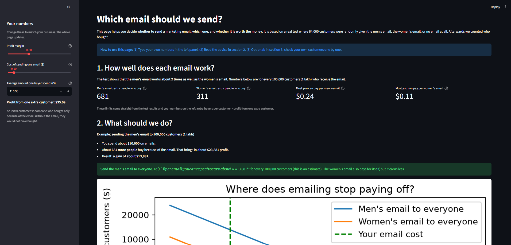
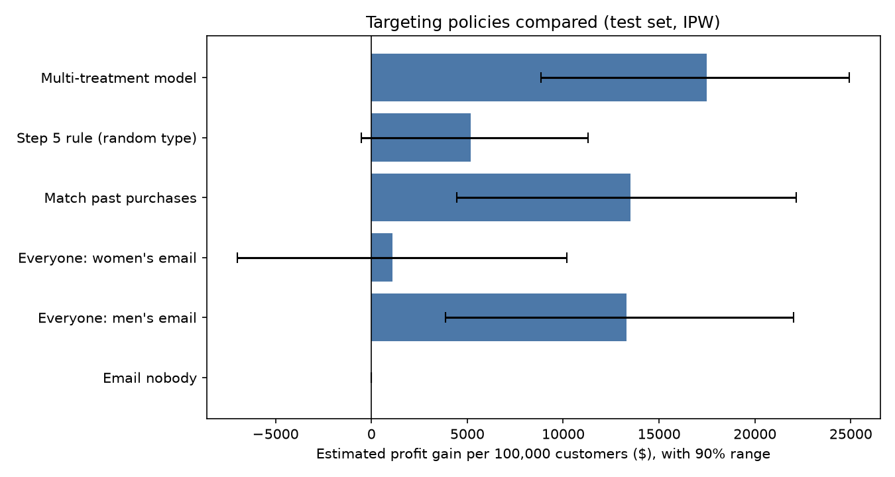
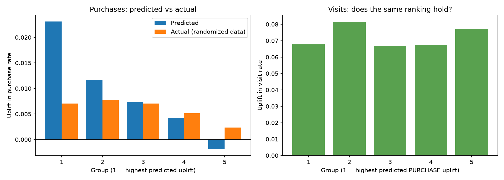
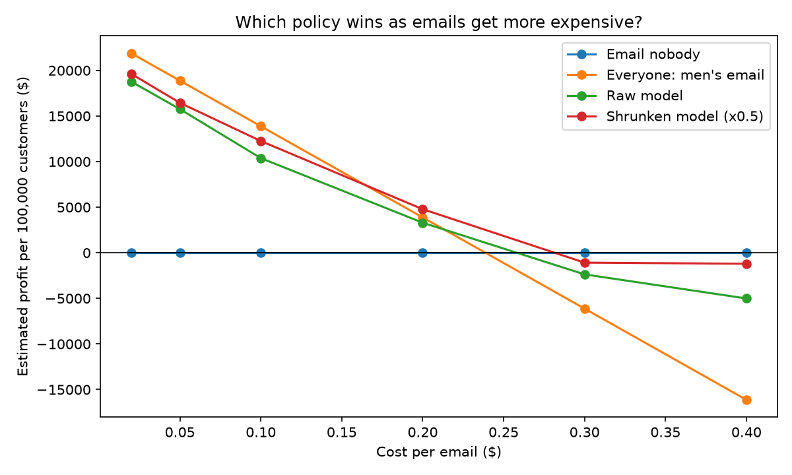

# Uplift Modeling on Email Marketing: What Actually Drives Profit?

**Live dashboard (Streamlit):** https://uplift-project.streamlit.app
**Live API (FastAPI docs):** https://uplift-project-qghb.onrender.com/docs
*(The API is on a free host: it sleeps after 15 minutes without traffic, so the first request can take about a minute.)*



I built uplift models on a randomized email experiment to decide *who* should get *which* email.
The main finding was a surprise: **which email you send matters far more than who receives it**,
and customer-level targeting did not beat a simple average-effect rule at any email cost I tested.

## Key findings
1. **The email works.** Conversion rose from 0.57% to 1.07% (randomization verified,
   all feature-balance checks p > 0.05).
2. **The men's email is about twice as effective as the women's:** about 681 vs 311 extra
   buyers per 100,000 customers (and 7,659 vs 4,523 extra website visits).
3. **Break-even rule:** with a 30% margin and $117 average buyer spend ($35 profit per extra buyer),
   an email pays for itself on average below about **$0.24 (men's)** and **$0.11 (women's)**.
4. **Customer-level targeting did not clearly help.** Raw model scores overstated uplift by
   about 1.8x, and the ranking did not carry over to a second outcome (visits).
   Shrinking scores toward the average helped, but never beat "send the men's email to
   everyone" with confidence. The closest case was $0.20 per email (66% of bootstrap resamples).

## Streamlit dashboard (`app.py`)
An interactive decision guide for a marketing manager. Sidebar sliders set **profit margin**,
**cost per email**, and **average spend of a buyer**.

1. **What the data says:** extra buyers per 100,000 customers for each email, and each
   email's break-even cost.
2. **Recommendation at your settings:** "send the men's email to everyone" (green), a
   "close to break-even, consider an A/B test" note (blue), or "do not send" (red) when the
   cost is above break-even. A chart shows profit against cost per email for both emails,
   with your chosen cost marked.
3. **Validation results:** an expandable table from the out-of-fold cost sweep.
4. **Customer scoring (experimental):** use the demo data or upload a CSV, get shrunken
   uplift scores per customer and an experimental plan (men's email / women's email / do
   not email), and download the result. **No profit figure is shown for this plan,** because
   validation did not support one.

The app is built on the findings below: the main recommendation uses randomized averages,
and the customer-level section is labeled as unproven.

```
streamlit run app.py
```

## Data
Hillstrom email marketing dataset: 64,000 customers randomly assigned to men's email,
women's email, or no email (578 buyers in total).

## Approach
1. EDA and randomization check (`step1_explore.py`)
2. Features and stratified split (`step2_prepare.py`)
3. Baseline T-learner (two LightGBM models), Qini curve, decile table (`step3_baseline_uplift.py`)
4. Optuna tuning on cross-validated Qini, compared with an S-learner and a past-spend rule (`step4_tune_compare.py`)
5. First profit-based targeting rule (`step5_business_decision.py`)
6. **Three-way treatment** (no email / men's / women's), policies compared with inverse
   propensity weighting (IPW) and bootstrap ranges (`step8_multi_treatment.py`)
7. **Out-of-fold scoring on all 64,000 customers**, three seeds, calibration check,
   visit-rate cross-check (`step9_robustness.py`)
8. **Cost sweep** ($0.02 to $0.40) and a shrinkage policy (`step10_cost_and_shrinkage.py`)
9. Streamlit dashboard, FastAPI service, data-drift check, tests, Docker, CI

## How the conclusion changed (and why I trust the later one)
My first evaluation used only the 19,200-customer test split (about 160 buyers):

| | Test split only | All customers, out-of-fold |
|---|---|---|
| Targeted model profit per 100k | $17,482 | $10,381 |
| Men's email to everyone | $13,299 | $13,879 |
| Model beats men's-to-all in | 84% of resamples | **8%** of resamples |

With few buyers, a single test set was too noisy to trust. Out-of-fold evaluation used about
three times more buyers and reversed the conclusion.

## Calibration check
Predicted extra buyers per 100k under the model's policy: 921. Estimated from the randomized
data: 520 (ratio 0.56). The top-scored group was predicted at +2.3 points of purchase rate but
actually delivered +0.7.

## Cost sweep (profit per 100,000 customers, out-of-fold)
| Cost per email | Email nobody | Men's email to everyone | Targeted (shrunken model) | Targeted beats men's-to-all in |
|---|---|---|---|---|
| $0.02 | $0 | $21,879 | $19,615 | 10% |
| $0.05 | $0 | $18,879 | $16,446 | 7% |
| $0.10 | $0 | $13,879 | $12,255 | 22% |
| $0.20 | $0 | $3,879 | $4,781 | 66% |
| $0.30 | $0 | -$6,121 | -$1,081 | 96% |
| $0.40 | $0 | -$16,121 | -$1,201 | 100% |

At $0.30 and above, the high win rates only mean the targeted plan lost less money than a
plan that loses a lot. Sending nothing was better.





## API (FastAPI)
| Endpoint | What it does |
|---|---|
| `GET /health` | Service status and loaded models |
| `GET /guide?cost_per_email=0.10` | Break-even recommendation from the randomized averages (no ML needed) |
| `POST /score` | Experimental uplift scores for up to 5,000 customers, validated with Pydantic |
| `POST /drift` | PSI data-drift check of at least 200 new customers against the training data |

```
pip install -r requirements-api.txt
uvicorn api.main:app --reload       # then open http://127.0.0.1:8000/docs
python -m pytest -v                 # 20 automatic checks
python examples/call_api.py         # call the running API from Python
python examples/check_drift.py      # normal vs deliberately shifted customers
```

**Drift check:** Population Stability Index compares the mix of new customers with the
training customers, per feature (below 0.10 stable, 0.10 to 0.25 moderate, above 0.25 major).
It detects changes in *who* the customers are, not in *how they respond* to an email; only a
new experiment can show that.

**Docker and CI:** the `Dockerfile` builds the API image. Every push runs the tests, builds the
image, and checks `/health` using GitHub Actions.

## Limitations
- Only about 1% of customers buy, so every estimate is noisy. Ranges are reported throughout.
- Margin, email cost, and "profit per extra buyer" are assumptions, not data. Profit counts
  only the first purchase, not lifetime value.
- Average effects used in the dashboard come from the same 64,000 customers they are
  evaluated on. With two numbers the optimism is tiny, but it is not zero.
- The shrink factor (0.5) was fixed in advance from the calibration ratio, not tuned.
- Final models are trained on all customers, so the validated (out-of-fold) numbers are the ones to quote.
- The API has no authentication, rate limiting, request logging, monitoring, or retraining
  pipeline, and the free host sleeps when idle.
- Next step in real life: an A/B test of the targeted plan against the simple plan.

## Run it yourself
Use the same Python version I used (the packages in `requirements.txt` are pinned to exact versions).
```
pip install -r requirements-dev.txt
python src/step1_explore.py
python src/step2_prepare.py
python src/step3_baseline_uplift.py
python src/step4_tune_compare.py
python src/step5_business_decision.py
python src/step8_multi_treatment.py
python src/step9_robustness.py
python src/step10_cost_and_shrinkage.py
python src/make_reference.py
streamlit run app.py
```
Download the data first from the Hillstrom source below and save it as `data/hillstrom.csv`.

## Project layout
```
app.py                 Streamlit dashboard
api/                   FastAPI service (main.py, schemas.py)
src/                   pipeline steps, features.py, policy.py, drift.py
tests/                 API and drift tests
examples/              scripts that call the API
models/                trained LightGBM models
outputs/               charts, configs, results
Dockerfile             API container
.github/workflows/     CI: tests + Docker smoke test
```

## Tech
Python, Pandas, NumPy, Scikit-learn, LightGBM, Optuna, SciPy, Matplotlib, Streamlit, FastAPI,
Pydantic, pytest, Docker, GitHub Actions.

Data: Kevin Hillstrom, MineThatData E-Mail Analytics and Data Mining Challenge (2008).